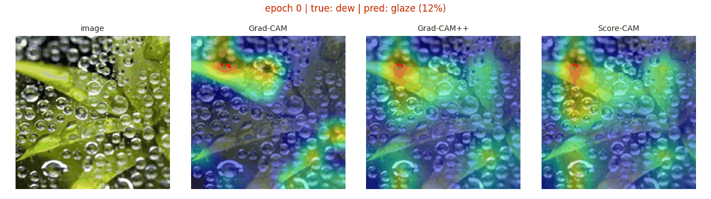
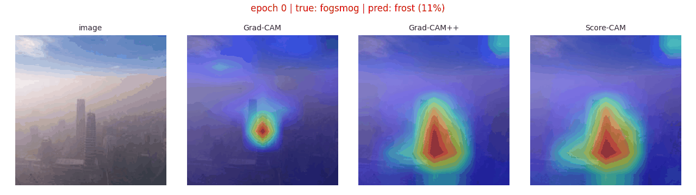
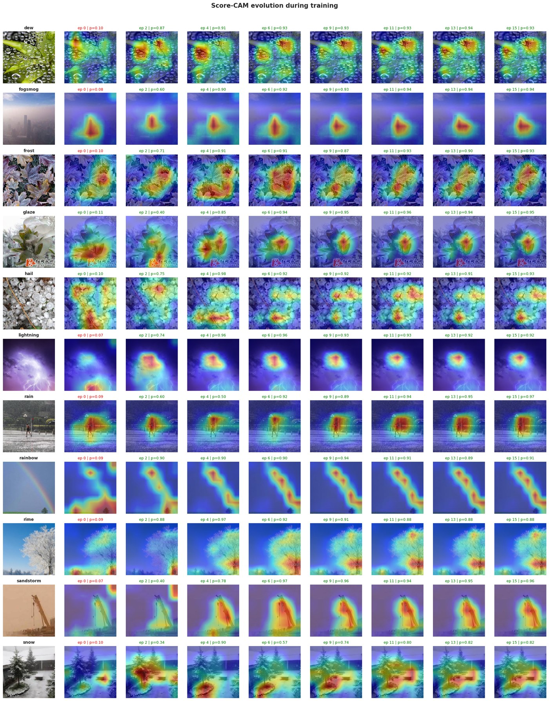
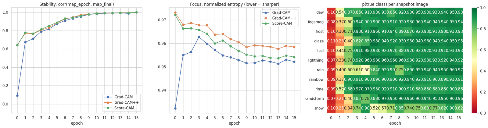
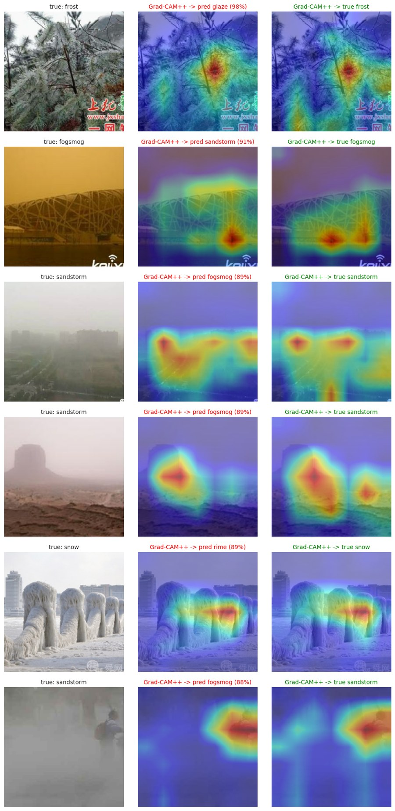

# Watching Where a CNN Looks While It Learns

Fine-tuning ResNet-50 on 11 weather classes while recording **Grad-CAM**, **Grad-CAM++** and **Score-CAM** after every epoch, to see how the model's attention forms during training.

  
  

## Results (hold-out test set)

| Accuracy | Macro F1 | Top-3 Acc |
|:-:|:-:|:-:|
| 93.4% | 0.940 | 99.2% |

## Attention evolution

Rows = one fixed validation image per class. Columns = epochs (0 = pretrained backbone + random head).

- **Stability**: correlation between each epoch's map and the final map. Attention is essentially settled by epoch ~9.
- **Focus**: normalized entropy of the map (lower = sharper). It drops steadily for Grad-CAM++ and Score-CAM as training goes on.
- At epoch 0, Grad-CAM++ and Score-CAM already correlate ~0.64 with the final map, vs ~0.09 for Grad-CAM.

## Where it looks when it fails

CAM for the predicted (wrong) class vs the true class on the most confident errors.

## Setup

- **Data**: [Weather Image Recognition](https://www.kaggle.com/datasets/jehanbhathena/weather-dataset), 6,862 images, 11 classes, stratified 70/15/15 split
- **Model**: ResNet-50 (ImageNet), 23.5M params, 8.2 GFLOPs
- **Training**: 2 epochs head-only, then full fine-tune with differential LR (head 1e-3, backbone 1e-4), AdamW, warmup + cosine, label smoothing, TrivialAugment, AMP, 2× T4
- **CAMs**: implemented from scratch with forward/backward hooks on `layer4`, no external CAM library

## Run

Open `weather-attention-gradcam-scorecam.ipynb` on Kaggle, add the dataset, select **GPU T4 x2** and run all.

## References

[Grad-CAM](https://arxiv.org/abs/1610.02391) · [Grad-CAM++](https://arxiv.org/abs/1710.11063) · [Score-CAM](https://arxiv.org/abs/1910.01279)
